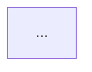

# Plantilla del archivo de trabajo

Estructura de `~/Systems Design Interviews/.en-curso/caso.md`. Se rellena de una vez al preparar el caso, salvo `Registro de la entrevista` y `Diseño del candidato`, que crecen durante la sesión. No se muestra al candidato.

~~~markdown
---
nivel: Junior | Mid | Senior | Staff/Principal
fecha: YYYY-MM-DD
slug: nombre-empresa-en-kebab-case
pistas: 0
penalizacion: 0
estado: entrevista | diseño | profundizacion | evaluacion
---

## Empresa

Nombre inventado, sector, tamaño, una o dos frases de contexto de negocio. Nada de nombres de empresas reales.

## Descripción del caso

El texto exacto que se le muestra al candidato. Breve: qué necesita la empresa y por qué ahora. Sin cifras ni restricciones que deban descubrirse preguntando. En Staff/Principal, vago a propósito.

## Contexto oculto

Todos los datos que el entrevistador puede revelar si se le pregunta, agrupados:

Un dato por línea, con una clave delante (`- nube: AWS eu-west-1`, `- arquitectura actual: monolito Symfony en 2 EC2`), para poder responder solo el dato pedido sin arrastrar los de al lado.

- **Usuarios y uso**: quién lo usa, cuántos, desde dónde, patrones de uso, picos.
- **Requisitos funcionales**: qué tiene que hacer, incluidos los que solo aparecen si se pregunta.
- **Requisitos no funcionales**: latencia, disponibilidad, consistencia, durabilidad, seguridad, normativa.
- **Volumen y crecimiento**: cifras concretas y crecimiento esperado.
- **Entorno técnico existente**: nube o infraestructura propia, arquitectura actual, lenguajes, comunicación entre servicios, observabilidad, sistemas legacy.
- **Organización y negocio**: equipo, presupuesto, plazos, dependencias de otros equipos (sobre todo en Staff).

Cada dato debe ser concreto (cifras, nombres de tecnologías), para que las respuestas sean consistentes.

## Preguntas esperadas

| # | Pregunta | Peso | Qué destapa | Cómo cambia el diseño |
|---|---|---|---|---|
| 1 | ¿Cuántos usuarios activos diarios hay y con qué picos? | alto | 2 M DAU, picos de 10x los lunes a las 9:00 | Obliga a desacoplar con cola y a escalar consumidores |

Entre 8 y 12 en Junior, 10 y 15 en Mid, 12 y 20 en Senior y Staff. Pesos: alto, medio, bajo.

## Trampas y requisitos ocultos

| # | Trampa | Tipo | Preguntas que la destapan | Qué falla si no se descubre |
|---|---|---|---|---|

Número de trampas según `levels.md`.

## Preguntas innecesarias típicas

| Pregunta | Por qué no aporta |
|---|---|
| ¿Qué preprocesador CSS usáis? | Es un detalle de frontend que no condiciona la arquitectura del sistema. |

Entre 5 y 8.

## Solución de referencia

Descripción en prosa: componentes, responsabilidades, flujo de datos, almacenamiento, comunicación, cómo se cubre cada requisito crítico y cada trampa, principales trade-offs y alternativas válidas. Indicar explícitamente qué divergencias serían aceptables.

## Diagrama de referencia

## Registro de la entrevista

| # | Pregunta | Categoría | Respuesta dada (datos exactos) | Dato nuevo |
|---|---|---|---|---|

Categorías: esperada (con número de la tabla), útil, dudosa, innecesaria, prematura, pista, suposición confirmada, suposición corregida. "Dato nuevo" recoge cualquier dato que el entrevistador haya tenido que inventar porque no estaba en el contexto oculto; a partir de ese momento forma parte del contexto.

## Diseño del candidato

Texto del diseño tal como lo presentó, su diagrama (Mermaid o ruta a la imagen) y las preguntas y respuestas de la profundización.
~~~
